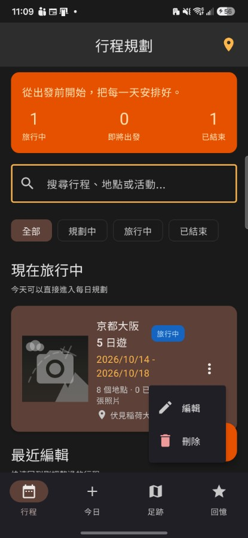
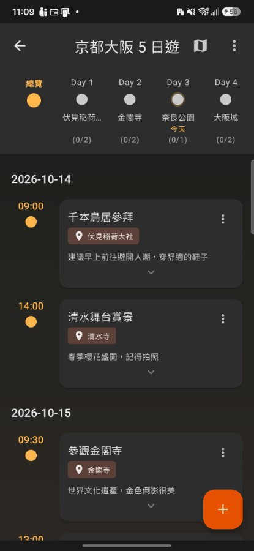
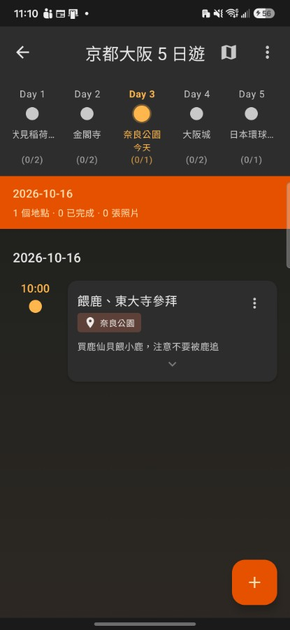
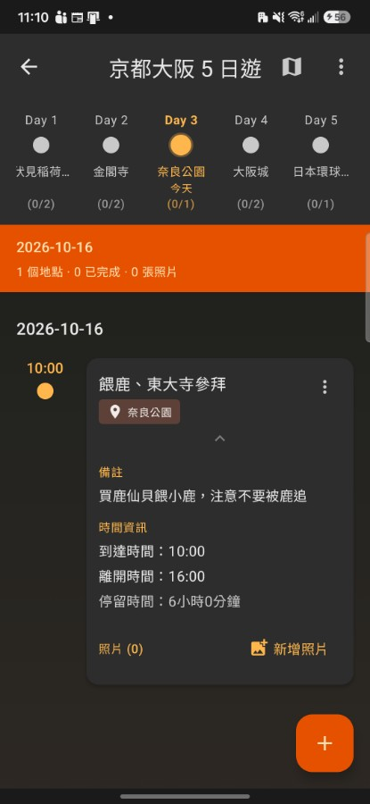
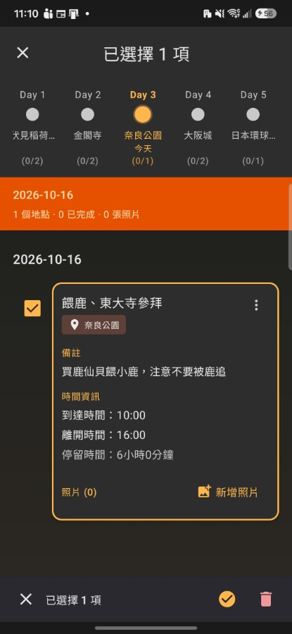

# TravelRecordList 產品規格書（現況版）

> 2026-10-27 從 Claude Docs 搬進專案，之後以這份為準。

2026-10-15

本規格書依 2026-10-15 的程式現況整理，描述 App 目前實際的行為，作為後續改版的基準。行為與直覺不同、尚未確定是否刻意的地方，列在「待確認事項」。

## 產品概述

TravelRecordList 是給自助旅行者用的「行程本＋旅行日記」：出發前排好每天要去哪，旅途中打卡、隨手記錄，回來後回顧去過的地方。不需要帳號，資料只存在手機上。

**目標使用者**：自己排行程的自助旅行者，例如海外自由行、國內多日遊。目前只支援一個人使用，沒有分享編輯或多人協作。

| 階段 | 使用者要做的事 | 主要入口 |
|---|---|---|
| 出發前 | 建立行程、排每天的地點與時間、看地點列表、產生路線 | 「行程」分頁 |
| 旅途中 | 看今天要去哪、到了打卡、補一筆紀錄、加照片與備註 | 「今日」分頁（行程詳情也能做） |
| 回來後 | 看去過哪些地點與統計、讀自動產生的旅行小故事 | 「足跡」、「回憶」分頁 |

**第一次開啟**：行程列表是空的時，系統會放入兩趟範例行程，讓使用者一開始就看得到每個分頁的樣子：

- 「京都大阪 5 日遊」：從昨天到大後天（共 5 天），打開就是「旅行中」，今日頁有內容。
- 「東京 3 日遊」：30 天前開始、已結束，足跡與回憶頁有內容。

**平台**：Android 是目前唯一完整可用的平台；iOS 有專案但多項功能未完成（見「外部服務與平台現況」）。

## 名詞定義

本文件與 App 畫面用的詞不完全一致，下表以本文件的用語為準，右欄列出畫面上的其他說法。

| 名詞 | 意思 | 畫面上的其他說法 |
|---|---|---|
| 行程 | 一趟旅行：標題、描述、開始與結束日期（可不填）、封面照片 | 旅行、旅程 |
| 項目 | 行程裡的一個安排：哪一天、去哪裡、做什麼，可加時間、備註、照片 | 地點（「N 個地點」算的是項目數）、紀錄 |
| 活動 | 項目要做的事，例如「千本鳥居參拜」 | — |
| 地點 | 項目去的地方：名稱必填，地址與座標只有從搜尋建議選取時才有 | — |
| 完成 | 項目已去過，系統記下完成時間 | 今日頁叫「打卡」、足跡頁叫「打卡」、其他頁叫「已完成」 |
| 行程階段 | 規劃中、旅行中、已結束，依今天與行程日期算出（見「資料欄位與共通規則」） | 規劃中在首頁摘要卡與區塊叫「即將出發」 |
| 進行中的旅行 | 今日頁顯示的那一趟：旅行中的行程裡結束日最早的 | — |
| 行程封面 | 建立或編輯行程時設定的一張照片，用在行程卡片與回憶 | — |
| 項目封面 | 項目照片中的一張；新增項目時第一張自動當封面，可在行程詳情改 | 「設為封面」 |
| 標籤 | 備註裡的 #字詞，儲存時自動抓出，例如備註「排隊 30 分 #拉麵」產生標籤「拉麵」 | Hashtag |
| 快速紀錄 | 今日頁新增一筆今天項目的簡化表單 | 新增現在 |
| 路線 | 依行程項目排出的地點順序清單，不另外存 | — |
| 足跡 | 去過的地點彙整：已打卡，或日期在今天以前的項目 | — |
| 回憶 | 已結束行程自動產生的故事卡片 | — |
| 範例行程 | 行程數為零時系統放入的兩趟示範行程 | — |

## 資訊架構

App 底部有四個分頁：行程、今日、足跡、回憶。只有「行程」分頁有上一頁／下一頁，其他三個各只有一個畫面。進入行程分頁的深層頁面時，底部分頁列會隱藏。

**資訊架構 · 4 個底部分頁、9 個畫面**

```
行程分頁：可以一層層進入、返回
└─ 行程列表（首頁）
   ├─ 建立行程 → 新增／編輯行程（建立成功後進入行程詳情）
   └─ 點行程卡片 → 行程詳情（「編輯行程」回到新增／編輯行程）
      ├─ ＋／編輯 → 新增／編輯項目
      ├─ 地圖圖示 → 地圖（地圖可進入編輯項目）
      └─ 生成路線 → 路線

其他分頁：各只有一個畫面，都能跳到行程詳情
├─ 今日：「看完整行程」→ 行程詳情
├─ 足跡：點卡片 → 行程詳情
└─ 回憶：點卡片 → 行程詳情
```

今日頁的「看完整行程」、足跡與回憶的卡片都能跳到行程詳情；行程列表右上角也能切到足跡。足跡與回憶仍不能直接點進單一項目。

**打開 App 停在哪個分頁**（2026-10-15 已實作，Android 實機驗證通過）

- App 從完全關閉的狀態打開時判斷一次：有「進行中的旅行」就停在「今日」，否則停在「行程」。
- 從背景切回來、旋轉螢幕都不重新判斷，維持使用者當下所在的分頁。
- 第一次安裝、從舊版升級後的第一次啟動，資料庫還是空的，停在「行程」；下一次啟動時範例行程是旅行中，就會進「今日」。
- 讀取行程失敗時停在「行程」。
- 判斷完成前畫面只顯示背景色，底部分頁列也先不出現。

## 行程列表（首頁）

**目的**：看到所有行程、找到要處理的那一趟、建立新行程。沒有旅行中的行程時，打開 App 停在這一頁。

**入口**：底部「行程」分頁的第一層；從行程分頁的任何深層頁一路返回，最後回到這裡。

**畫面**（2026-10-16 在 Android 實機截圖，資料是範例行程）

| 平常 | 搜尋「金閣」 | 篩選「已結束」 |
|---|---|---|
|  |  |  |
| 摘要卡、搜尋框、篩選列，下面依序是各區塊 | 只剩有「金閣寺」項目的京都行程，摘要卡數字跟著變，「最近編輯」因為只剩一筆而不顯示 | 只剩已結束的東京行程，「全部行程」顯示 1 筆 |

| 篩選沒有結果 | 卡片「⋮」選單 |
|---|---|
|  |  |
| 篩選「規劃中」沒有行程，卻顯示「還沒有行程」（修正前的畫面，2026-10-16 起改顯示「沒有符合的行程」）；右下「建立行程」蓋住了「建立第一個行程」 | 編輯、刪除 |

**畫面內容**（由上而下）

1. 標題「行程規劃」，右上角地點圖示，按下切到「足跡」分頁。
2. 摘要卡：「從出發前開始，把每一天安排好。」與三個數字：旅行中、即將出發、已結束。
3. 搜尋框「搜尋行程、地點或活動...」。
4. 篩選：全部、規劃中、旅行中、已結束，單選，預設「全部」。
5. 行程區塊，有內容才出現（見下表）。
6. 右下「建立行程」按鈕，進入建立行程頁。

| 區塊 | 收錄 | 排序 | 筆數上限 |
|---|---|---|---|
| 現在旅行中 | 旅行中的行程 | 結束日早的在前 | 不限 |
| 即將出發 | 規劃中的行程 | 開始日早的在前，沒填開始日的排最後 | 3 |
| 最近編輯 | 所有行程 | 最近修改的在前；只有一筆行程時整區不顯示 | 3 |
| 全部行程 | 所有行程，標題旁顯示筆數 | 建立時間新的在前 | 不限 |

同一趟行程可能同時出現在好幾個區塊。例如旅行中的「京都大阪 5 日遊」會同時出現在「現在旅行中」「最近編輯」「全部行程」。

**行程卡片**

- 封面照片，沒設封面時顯示預設圖。
- 標題（最多兩行）與階段標籤：規劃中、旅行中或已結束。
- 日期範圍；只填了一個日期時顯示「開始：…」或「結束：…」，都沒填就不顯示。
- 「N 個地點 · M 已完成 · P 張照片」。「地點」算的是項目數，同一個地點排了兩次算兩個。
- 出現最多次的地點名稱。
- 右側「⋮」選單：編輯、刪除。

**操作與規則**

- 點卡片：進入行程詳情。
- ⋮ → 編輯：進入編輯行程頁。
- ⋮ → 刪除：跳出確認「確定要刪除「京都大阪 5 日遊」嗎？這個動作無法復原。」，確認後刪除行程與它所有的項目，列表重新讀取。
- 搜尋：邊打邊篩選，不分大小寫，比對行程標題、描述，以及行程內項目的地點名稱與活動。例如搜「金閣」，會找到含有「金閣寺」項目的行程。
- 搜尋與篩選同時生效；摘要卡的三個數字與各區塊都跟著結果變動。
- 下拉重新整理；每次回到這一頁都會重新讀取。
- 每次啟動 App 時，先把舊版資料搬進新的儲存方式，再檢查行程數：一筆都沒有就放入兩趟範例行程。

**狀態**

- 讀取中：灰色的卡片骨架。
- 沒有行程：「還沒有行程」「先建立一趟旅行，再安排每天要去的地點。」與「建立第一個行程」按鈕。搜尋或篩選找不到結果時，改顯示「沒有符合的行程」（2026-10-16 修正）。
- 讀取失敗：篩選列下方顯示紅字錯誤訊息；啟動時資料準備失敗，顯示「資料準備失敗：」加上原因。
- 刪除失敗：底部提示錯誤訊息（2026-10-16 修正）。

**已知問題與待確認**：摘要卡寫「即將出發」、篩選寫「規劃中」，指的是同一群行程；右上角的足跡按鈕跟底部分頁重複。詳見「已知問題」與「待確認事項」。

**可以改善的地方**（2026-10-16 對照截圖整理；只是建議，要不要做另外決定）

- 篩選或搜尋沒有結果時，已改顯示「沒有符合的行程」（已知問題 #6，2026-10-16 已修）；還可以加上「清除篩選」按鈕，留給設計基準一起決定。
- 空畫面時，右下「建立行程」會蓋住「建立第一個行程」；兩個按鈕做同一件事，可以只留一個（新發現）。
- 卡片的標題、日期、統計被階段標籤和「⋮」擠到斷行，例如「京都大阪／5 日遊」。卡片資訊順序是改善計畫已決定要做的項目，等設計基準。
- 摘要卡寫「即將出發」、篩選寫「規劃中」，指的是同一群行程，用語可以統一（待確認 #16）。
- 同一趟行程重複出現在「現在旅行中」「最近編輯」「全部行程」（待確認 #12）；右上足跡按鈕與底部分頁重複（待確認 #13）。

## 建立與編輯行程

**目的**：建立一趟新旅行，或修改既有行程的基本資料。兩者是同一個表單，標題分別是「新增行程」與「編輯行程」。

**入口**

- 新增：行程列表的「建立行程」或空狀態的「建立第一個行程」。
- 編輯：行程卡片的「⋮ → 編輯」、行程詳情右上「⋮ → 編輯行程」，以及新增項目時行程沒填日期的引導。

**欄位**

| 欄位 | 必填 | 規則 |
|---|---|---|
| 封面照片 | 否 | 從相簿挑一張；可移除 |
| 行程標題 | 是 | 不可空白，空白時顯示「標題不可為空」；沒有長度上限，可以輸入換行 |
| 描述 | 否 | 最多顯示 5 行 |
| 開始日期 | 否 | 按「選擇」開日曆，顯示為 2026-10-14 這種格式；設定後無法清除 |
| 結束日期 | 否 | 同上；兩個都有填時，結束不能早於開始，否則顯示「結束日期不能早於開始日期」 |

**操作與規則**

- 按「儲存」：檢查標題與日期，通過才存檔。儲存中按鈕停用。
- 新增成功：直接進入新行程的詳情頁；按返回回到行程列表，不會回到表單。
- 編輯成功：回到上一頁。
- 儲存失敗：底部提示錯誤訊息，表單內容保留。
- 選封面照片：選好立刻存成檔案並顯示，行程原本的封面檔要等按「儲存」成功才刪，沒儲存就離開時原封面保留；這次挑了又換掉或移除的封面檔立刻刪除。挑了新封面卻沒儲存就離開，新挑的檔案會留在手機裡。
- 縮短日期範圍時，已經排在範圍外的項目不會被刪除或搬動，也沒有提醒。
- 離開未儲存的「新增行程」：只要填了任何欄位（含封面），按返回或系統返回都會跳出「捨棄變更？」「您有未儲存的變更，確定要離開嗎？」，可選「捨棄」或「繼續編輯」。
- 離開未儲存的「編輯行程」：不會跳確認，直接離開、修改沒有存。
- 草稿：新增行程時，標題、描述、開始與結束日期停止輸入 1 秒後自動存成草稿，並在「新增行程」標題下方顯示「✓ 已自動儲存草稿」約 3 秒；提示不佔表單位置，儲存按鈕不會跟著移動（2026-10-22 實機驗證）；封面不存進草稿。下次開啟新增行程時帶回草稿（最後一次存檔後 7 天內有效），建立成功後清掉。編輯行程不存草稿。在「捨棄變更？」按「捨棄」會先清掉草稿再離開，下次開啟是空白的（2026-10-20 實機驗證）。

**狀態**

- 編輯時讀不到行程：顯示「找不到行程」。
- 封面存檔失敗：顯示「儲存封面照片失敗」。

**已知問題與待確認**：標題可輸入換行（改善計畫已決定維持）；日期無法清除；編輯時離開不提醒。

## 行程詳情

**目的**：看一趟行程每天的安排，並在這裡新增、修改、打卡、管理照片。這是整個 App 功能最多的一頁。

**入口**：行程列表點卡片；建立行程成功後自動進入；今日頁的「看完整行程」或「開啟行程時間軸」。

**畫面**（2026-10-16 在 Android 實機截圖，資料是範例行程）

| 總覽 | 選 Day 3（今天） | 展開項目卡片 |
|---|---|---|
|  |  |  |
| 時間軸每天都顯示第一個地點與完成數；列表依日期分組 | 只剩 10/16 的奈良公園，上方多了當日摘要 | 備註、到達／離開／停留時間、照片與「新增照片」 |

| 「⋮」選單 | 選擇模式 | 刪除行程的確認 |
|---|---|---|
|  |  |  |
| 選擇模式、生成路線、編輯行程、刪除行程 | 標題變成「已選擇 1 項」，底部工具列：取消、標記完成、刪除 | 文字與行程列表一致；按取消行程不變 |

**畫面內容**（由上而下）

1. 頂部列：返回、行程標題、地圖圖示（進入地圖頁）、「⋮」選單：選擇模式、生成路線、編輯行程、刪除行程。
2. 時間軸：行程的開始與結束日期都有填才顯示。最左是「總覽」，後面每天一個「Day N」。每天都顯示當天第一個地點與「(已完成/總數)」，今天多一個「今天」標記；選中的那天圓點放大並變色；沒有項目的天數是虛線空心圓。
3. 當日摘要：選了某一天才出現，顯示日期與「N 個地點 · M 已完成 · P 張照片」；當天沒項目時有「新增這天」。
4. 項目列表：依日期分組，每組上方是日期（顯示為 2026-10-20）。組內依時間排序（有抵達時間用抵達，否則用出發），**沒排時間的排在最後**。
5. 右下「＋」新增項目；往下捲時隱藏、往上捲時出現。

**項目卡片**

- 左側時間軸線：抵達與出發時間、完成狀態。
- 收合時：封面照片（有的話）、活動名稱（已完成時變淡）、地點標籤、標籤列（例如 #京都）、備註預覽、「已完成」標記、展開箭頭。
- 點卡片展開：備註全文、時間資訊（到達時間、離開時間、停留時間）、「照片 (N)」與「新增照片」、照片列。
- 「⋮」：標記完成（或標記未完成）、編輯、刪除。

**操作與規則**

- 選日期：點「Day N」只顯示當天項目、列表自動捲到該天；點「總覽」顯示全部。
- 標記完成：立即反映在卡片上並存檔；存檔失敗時恢復原狀態並提示。
- 刪除項目：先確認「確定要刪除「千本鳥居參拜」嗎？此操作無法復原。」。
- 新增項目：右下「＋」進入新增項目，日期自己選；「新增這天」與空狀態的按鈕會預先帶入那一天。
- 照片：「新增照片」從相簿挑一張。點縮圖開啟預覽，可「設為封面」或「刪除」，刪除前會確認；縮圖上的「選項」選單也能設封面或刪除，但刪除**不確認**。
- 選擇模式：「⋮ → 選擇模式」後，標題變成「已選擇 N 項」，點卡片勾選；底部工具列可刪除、標記完成、取消。刪除前確認「確定要刪除所選的 N 個項目嗎？此操作無法復原。」；完成後提示「已刪除 N 個項目」或「已標記 N 個項目為完成」並離開選擇模式。
- 生成路線：成功後進入路線頁；行程不到兩個不同地點時提示「至少要有兩個不同的地點才能生成路線」。
- 刪除行程：先確認「確定要刪除「京都大阪 5 日遊」嗎？這個動作無法復原。」（跟行程列表一致），確認後刪除行程與所有項目並回到列表；取消則不變。
- 標籤：卡片上的 #標籤只顯示，不能點；點到它等於點卡片，會展開或收合。

**狀態**

- 讀取中：整頁讀取畫面。
- 找不到行程：「找不到行程」。
- 行程沒有任何項目：「還沒有行程項目」與「新增第一個地點」。
- 選的那天沒有項目：「這一天還沒有安排」與「新增這天的第一個地點」。
- 讀取錯誤：列表上方紅字。

**已知問題與待確認**：「新增照片」曾一次無法開相簿，之後未能重現；縮圖選單刪照片不確認、預覽刪照片會確認；沒排時間的項目在這裡排最後、在今日頁排最前；日期在這頁顯示為 2026-10-20、在其他頁顯示為 2026/10/20；「Day N」與中文介面混用。

**可以改善的地方**（2026-10-16 對照截圖整理；只是建議，要不要做另外決定）

- 「⋮ → 生成路線」用的是分享圖示，容易以為是分享，可以換成路線圖示（新發現）。
- 選擇模式的底部工具列只有圖示、沒有文字，「標記完成」和「刪除」要用猜的（新發現）。
- 進入選擇模式時，原本展開的卡片仍維持展開，一次看不到幾張卡片，不好多選（新發現）。
- 停留時間顯示「6小時0分鐘」，可以簡化成「6 小時」（新發現）。
- 標記完成後，時間軸的完成數不會更新（已知問題 #9，2026-10-16 已修）。
- 「Day N」與中文介面混用、分組日期 2026-10-16 與其他頁的 2026/10/16 不一致（待確認 #16）。

## 新增與編輯項目

**目的**：在行程裡安排「哪一天、去哪裡、做什麼」，或修改已經排好的項目。新增與編輯共用同一組欄位，標題分別是「新增項目」與「編輯項目」。

**入口**

- 新增：行程詳情右下「＋」（不帶日期）；「新增這天」「新增這天的第一個地點」「新增第一個地點」（帶入當天日期）。
- 編輯：項目卡片「⋮ → 編輯」。地圖頁的項目也能進入編輯。
- 今日頁的「快速紀錄」是另一個較簡單的新增方式，見「今日」。

**欄位**

| 欄位 | 必填 | 規則 |
|---|---|---|
| 活動 | 是 | 空白時顯示「活動不可為空」 |
| 地點名稱 | 是 | 邊打邊出現搜尋建議；選了建議會自動帶入地址與座標。空白時顯示「地點名稱不可為空」 |
| 日期 | 是 | 下拉選單，只能選行程範圍內的日子；沒選顯示「請選擇日期」 |
| 地點地址 | 否 | 可手動修改；有座標時下方顯示「座標: 35.0394, 135.7292」 |
| 到達時間 | 否 | 按「選擇」開時間選擇器 |
| 離開時間 | 否 | 同上；兩個都有填時，離開不能早於到達 |
| 照片 | 否 | 「新增照片」一次最多選 5 張，可以重複加；縮圖可移除，點縮圖可預覽 |
| 備註 | 否 | 寫在備註裡的 #字詞 會自動變成標籤（見「資料欄位與共通規則」） |

前三個是必填，後面放在「選填資訊」區塊。

**操作與規則**

- 按「儲存」：依序檢查活動、地點名稱、日期，一次只顯示第一個錯誤。儲存成功回到行程詳情。
- 離開時間早於到達時間：按儲存後才提示「離開時間不能早於到達時間」。
- 新增時有照片：第一張自動成為項目封面。
- 行程沒填完整日期：日期欄顯示「行程尚未設定日期範圍」與「前往設定日期範圍」，按下會關掉這個表單、改開編輯行程。也就是說，**沒有日期的行程無法新增項目**。
- 離開未儲存的「新增項目」：只要填了活動、地點、地址、備註、時間或照片，就會跳出「捨棄變更？」。只選了日期不算。
- 離開未儲存的「編輯項目」：不跳確認，直接離開。
- 編輯時可以把項目改到行程範圍內的另一天。

**狀態**

- 讀不到行程：「找不到行程」。
- 儲存失敗：底部提示錯誤訊息，表單內容保留。
- 照片存檔失敗：提示「照片加入失敗」，那張照片不會出現。

**已知問題與待確認**：沒有日期的行程無法新增項目；「離開早於到達」要按儲存才告訴使用者；編輯項目離開不提醒。

## 今日

**目的**：旅行途中用的頁面。不用進行程詳情找今天，直接看到今天要去的地點、到了打卡、隨手補一筆紀錄。

**入口**：底部「今日」分頁（圖示是「＋」）。有旅行中的行程時，打開 App 會直接停在這一頁（規則見「資訊架構」）。每次切到這個分頁都會重新讀取，讀取時整頁只顯示讀取圈。

**哪趟行程算「進行中」**：開始與結束日期都有填、且今天落在兩者之間（含頭尾）的行程。同時有好幾趟符合時，取結束日最早的那趟。例如今天 10/15，行程 A 是 10/10–10/20、行程 B 是 10/14–10/16，今日頁顯示 B。

**畫面內容（有進行中的行程）**

1. 頂部「今日」與重新整理。
2. 行程卡：「今天 2026/10/15」、行程標題、進度「1/3 已完成」與進度條（今天沒項目時顯示「今天還沒有安排」）、「開啟行程時間軸」。
3. 「新增現在」與「看完整行程」兩個按鈕。
4. 今天的項目卡片：時間（沒排時間顯示「未排時間」）、活動、地點、備註，以及三個按鈕：「打卡」（已完成時顯示「完成」）、「照片 N」、「備註」。
5. 右下「快速紀錄」。

項目排序：依時間（有抵達用抵達，否則用出發），時間相同依建立先後；**沒排時間的排在最前面**。

**操作與規則**

- 打卡：立即變「完成」並記下完成時間；再按一次恢復未完成，不確認。存檔失敗時還原並提示。
- 備註：開「更新備註」對話框、帶入原本的備註；儲存後提示「備註已更新」，失敗時對話框保持開啟。
- 照片 N：從相簿挑一張加到該項目，提示「已加入照片」。
- 「看完整行程」或「開啟行程時間軸」：切到「行程」分頁，把該分頁原本開著的頁面收回列表，再打開這趟行程的詳情。
- 地點標籤只顯示，不能點。

**快速紀錄**（從右下「快速紀錄」、「新增現在」或空狀態的「新增第一筆」打開）

- 從下方彈出的面板，說明「預設加入 2026/10/15 · 京都大阪 5 日遊」。
- 欄位：活動（必填，空白顯示「請輸入活動」）、地點（必填，有搜尋建議，空白顯示「請輸入地點」）、備註、「加入照片 N」（一次最多 3 張，可重複加）。
- 選了搜尋建議會帶入地址與座標；之後又手動改地點文字，地址與座標會清掉。
- 「儲存到今日」：新增一個項目到進行中行程，日期是今天，**抵達時間是按下儲存的當下**；成功後清空表單、提示「已加入今日紀錄」。
- 活動與地點都有填時，按下儲存面板就立刻關閉，不等存檔結果。存檔失敗時提示錯誤，內容保留，重開面板還在。
- 沒儲存就關掉面板，內容保留到下次打開。

**狀態**

- 沒有進行中的行程：「今天沒有旅行中的行程」「今天是 2026/10/15，目前沒有日期涵蓋今天的行程。」與「回行程規劃」（只切分頁）；不顯示快速紀錄。
- 今天沒有項目：「今天還沒有行程」「可以先用快速紀錄，把現在去過的地方、照片和備註補上。」與「新增第一筆」。
- 讀取行程失敗：顯示成「今天沒有旅行中的行程」，看不到錯誤。
- 讀取項目失敗：行程卡照常顯示，下方紅字錯誤，同時出現「今天還沒有行程」。

**已知問題與待確認**：「照片 N」曾一次無法開相簿，之後未能重現；讀取行程失敗時看不到錯誤；快速紀錄不等存檔結果就關面板；分頁圖示是「＋」；沒日期的行程永遠不會出現在這裡。

## 地圖與路線

兩個畫面都從行程詳情進入，都是「地點列表＋跳到 Google 地圖」，目前 App 內沒有真正的地圖。

### 地圖頁

**目的**：按天看這趟行程要去的地點，並一鍵跳到 Google 地圖。

**入口**：行程詳情頂部的地圖圖示。

**畫面內容（Android）**

- 頂部：返回、行程標題、日期篩選選單（「顯示全部」與行程的每一天，日期顯示為 2026-10-14）。
- 提示列「點擊地點查看詳情，或開啟 Google Maps」。
- 依日期分組，每組標題「Day N · 日期」與「N 個地點」，每天一個顏色。
- 每個地點一張卡片，點卡片後底部出現資訊卡：當天順序「#2」、活動、地點，以及「編輯此項目」。
- 卡片上有按鈕可開啟 Google 地圖（沒裝 App 時開網頁版）。

**規則**

- **只顯示有座標的項目**。座標只有在新增／編輯項目時從搜尋建議選地點才會有；手動打字的地點不會出現在地圖頁。
- 排序：依日期、再依時間；沒排時間的排在當天最前面。
- 開啟 Google 地圖時用**地點名稱**搜尋，不是用座標。
- 「編輯此項目」進入編輯項目。

**狀態**

- 整趟行程都沒有座標：「行程中的項目沒有座標資訊」「請在項目中設定地點座標」。
- 篩選的那天沒有可顯示的地點：「此日期沒有可顯示的地點」。
- iOS：只顯示佔位文字，沒有列表。

### 路線頁

**目的**：把整趟行程的地點排成一條順序，可以分享。

**入口**：行程詳情「⋮ → 生成路線」。路線不另外存，每次打開都依行程當下的項目排出來；行程改了，下次打開就跟著變。

**路線怎麼產生**

- 取行程的所有項目，依日期、時間排序，**整趟旅行合成一條**，不分天。
- 同名的地點只留第一次。例如 Day 1 與 Day 4 都回「飯店」，路線上只有 Day 1 那一個。
- 不到兩個不同地點時無法產生。

**畫面內容**

- 頂部：返回、路線標題（同行程標題）、分享按鈕。
- 資訊卡：標題與「N 個地點」。
- 「路線地點」列表：順序編號、地點名稱、地址、「座標：34.9671, 135.7727」（有座標時）、開啟 Google 地圖按鈕。

**規則**

- 開啟 Google 地圖：有座標用座標，沒有就用地址或名稱。（跟地圖頁的做法不同。）
- 分享：開啟系統分享選單「分享行程路線」，分享出去的是一段程式資料格式（JSON）的文字，一般人看不懂。

**狀態**：找不到路線時顯示「找不到路線」。

**已知問題與待確認**：兩個畫面功能重疊；路線不分天、重複地點被合併；分享內容是 JSON；沒有座標的地點不會出現在地圖頁；兩頁開 Google 地圖的方式不同；畫面直接顯示經緯度數字。

## 足跡

**目的**：以「一趟旅行」為單位，彙整去過的地點與打卡數。

**入口**：底部「足跡」分頁（圖示是地圖）；行程列表右上角的地點圖示。每次切過來都會重新讀取；右上角可手動重新整理。

**畫面內容**

1. 摘要卡：三個數字「旅行」「地點」「打卡」。
2. 每趟旅行一張卡片：行程標題、「N 個地點 · M 打卡 · 2026/10/14 - 2026/10/18」、展開箭頭。
3. 展開後列出每個地點：地點名稱、活動、日期；已打卡的地點是勾勾圖示，其他是地點圖示。一次只展開一趟。

**規則**

- **只收錄去過的地點**（2026-10-16 起）：已打卡，或日期在今天以前的項目才算；今天還沒打卡的不算。例如今天是 10/16，京都行程 10/14–10/18 都還沒打卡，就只算 10/14、10/15 的地點；下個月的「東京 5 日遊」出發前不會出現在足跡。
- 「旅行」只算至少有一個去過地點的行程；「地點」算的是去過的項目數，同一地點去兩次算兩個；「打卡」是已完成的項目數。
- 卡片上的日期範圍取去過的項目的第一天到最後一天，不是行程設定的日期。
- 旅行依最後一個去過的項目的日期排序，新的在前。
- 點卡片會切到「行程」分頁並打開該行程詳情，返回回到行程列表；右側箭頭只負責展開、收合。展開後的地點列不能點。
- 沒有地圖：分頁圖示是地圖，內容是列表。

**狀態**

- 讀取中：讀取圈。
- 還沒有去過的地點：「還沒有走過的地方」「打卡或旅行日期過了之後，這裡會按旅行收攏你去過的地方。」，沒有下一步按鈕。
- 讀取失敗：底部提示「載入足跡失敗」或原因。

**已知問題與待確認**：分頁圖示是地圖但沒有地圖；空狀態沒有下一步按鈕；與「回憶」分頁內容重疊。

## 回憶

**目的**：旅行結束後，把一趟旅行整理成一張帶故事的卡片，讓使用者回味。

**入口**：底部「回憶」分頁。每次切過來都會重新讀取；右上角可手動重新整理。

**收錄哪些行程**：只有「已結束」的行程，也就是結束日期已經過了（不含今天）。沒填結束日期的行程永遠不會出現。依結束日期排序，新的在前。

**回憶卡片**

- 封面：行程封面；沒有就用項目裡的第一張照片。
- 故事標題、行程標題、日期範圍、一句摘要。
- 「N 個地點」「N 張照片」。
- 「展開故事與每日亮點」：展開後顯示一段敘事，以及「每日亮點」（每天一行：日期、當天的代表活動、N 個地點）。一次只展開一張。
- 點卡片會切到「行程」分頁並打開該行程詳情，返回回到行程列表；「展開故事與每日亮點」的箭頭只負責展開、收合（2026-10-16 起）。

**故事怎麼產生**：在手機上用固定句型組合行程資料，不連網、不使用 AI。例如：

- 標題：「秋天 的 京都」。季節依開始月份（3–5 月春天、6–8 月夏天、9–11 月秋天、12–2 月冬天），地名取出現最多次的地點，沒有就用行程標題。
- 摘要：「10 月的 京都 之旅，走了 4 天、8 個地方。」。「天數」是有安排項目的天數，不是行程長度。
- 敘事：依第一個與最後一個地點、打卡比例（全部打卡、都沒打卡、部分打卡三種說法）、照片數組成。
- 每日亮點：當天第一個已打卡的項目的活動；都沒打卡就取當天第一個項目。

**狀態**

- 讀取中：讀取圈。
- 沒有已結束的行程：「還沒有可以回味的旅程」「等行程的結束日期過了之後，這裡會留下屬於你的故事。」，沒有下一步按鈕。
- 讀取失敗：底部提示「載入回憶失敗」或原因。

**已知問題與待確認**：卡片點不進照片；故事文字在中文與地名之間有多餘空格（「秋天 的 京都」）；沒結束日期的行程永遠進不了回憶；空狀態沒有下一步按鈕。

## 資料欄位與共通規則

### 資料欄位

| 資料 | 欄位 | 必填 |
|---|---|---|
| 行程 | 標題 | 是 |
| 行程 | 描述、開始日期、結束日期、封面照片 | 否 |
| 行程 | 建立時間、最後修改時間 | 系統自動 |
| 項目 | 所屬行程、日期、活動、地點名稱 | 是 |
| 項目 | 到達時間、離開時間、地址、座標、備註、照片 | 否 |
| 項目 | 標籤（從備註抓）、封面照片、完成狀態與完成時間、建立與修改時間 | 系統自動或由操作產生 |

### 行程階段怎麼判定

「今天」依手機的時區計算。首頁的階段標籤與篩選、今日頁、回憶都用同一套規則：

| 條件 | 階段 | 例子（今天 10/15） |
|---|---|---|
| 開始與結束都有填，今天在兩者之間（含頭尾） | 旅行中 | 10/14–10/18 |
| 有填結束日期，且今天已過了結束日 | 已結束 | 9/15–9/17；只填結束 10/01 |
| 其他所有情況 | 規劃中 | 11/01–11/05；沒填日期；只填開始 10/01 |

注意最後一列：只填了開始日、而且開始日已經過了，行程仍算「規劃中」。

### 同一天內的項目排序

各畫面都先看時間（有到達用到達，沒有就用離開），但「沒排時間」的項目放哪裡各畫面不同：

| 畫面 | 沒排時間的項目 |
|---|---|
| 行程詳情 | 當天最後 |
| 今日 | 最前面 |
| 地圖 | 當天最前面 |
| 路線 | 當天最前面 |

### 標籤

- 儲存項目時從備註抓出「# 後面緊接的英數字、底線或中文字」。例如「#京都 #night_view」產生「京都」與「night_view」。
- 日文假名、表情符號、空格會中斷標籤：「#すし」不會產生標籤。
- 同一個項目重複的標籤只算一次。
- 目前標籤只用來顯示，沒有任何篩選或搜尋用到。

### 刪除的連帶效果

- 刪除行程：它的所有項目一起刪除。
- 刪除項目或行程時，項目的照片與縮圖、行程封面的檔案會一起從手機刪除，刪檔失敗不影響刪除結果。仍會留在手機裡的檔案：在表單裡移除的照片、挑了卻沒儲存就離開的新照片或新封面，以及這個版本之前留下的檔案。
- 所有刪除都無法復原，沒有垃圾桶或復原功能。

### 範例行程

每次啟動 App，只要行程數是零，就放入兩趟範例行程。使用者把所有行程刪光後重開 App，範例會再出現。

## 外部服務與平台現況

### 地點搜尋（Google Places）

- 是 App 唯一需要網路的功能，用在新增／編輯項目與快速紀錄的地點欄。
- 使用者停止輸入 0.8 秒後送出一次搜尋，建議以繁體中文顯示。每次搜尋都會產生 Google 的費用。
- 沒有網路、金鑰無效或其他錯誤時，建議清單不出現，也沒有任何提示；使用者仍可手動打地點名稱，但那筆地點沒有座標，不會出現在地圖頁。
- API 金鑰目前寫在 App 安裝檔裡，有被取出盜用的風險，盜用的費用由開發者承擔。處理方案記在另一份文件「TravelRecordList 改善計畫」。

### 資料儲存

- 所有資料只存在手機上：行程與項目存在資料庫，照片是 App 內的檔案，草稿存在另一個小型儲存區。
- 沒有帳號、雲端同步，也沒有行程資料的匯出、匯入（只有路線能分享成一段文字）。解除安裝或換手機時，資料能不能保住取決於 Android 系統備份：App 有開啟系統備份，但沒有驗證過還原。
- 舊版本升級上來時，第一次啟動會自動把舊資料搬進資料庫；2026-10-15 已在 Android 實機驗證行程、項目、照片、完成狀態都有保留。

### 平台

| 項目 | Android | iOS |
|---|---|---|
| 可安裝的系統版本 | Android 7.0 以上 | 未定 |
| 建置與實機測試 | 有 | 沒有在 Mac 上建置過目前的版本 |
| 地點搜尋 | 可用（需設定金鑰） | 一定失敗：還沒實作讀取金鑰 |
| 照片 | 可用 | 不可用：照片不會真的存下來 |
| 地圖頁 | 地點列表＋跳 Google 地圖 | 只顯示「地圖功能」「iOS 版本開發中」 |
| 分享路線 | 系統分享選單 | 有實作，未驗證 |
| 舊資料搬移 | 已驗證 | 未驗證 |

Web：專案說明文件寫支援 Web，但目前程式沒有建置 Web 版，視為不支援。

## 已知問題

以下是確定與預期不符的地方，依對使用者的影響排序。「依據」欄的「實機」表示在 Android 手機上看到過，「程式」表示讀程式確認、還沒在手機上重現。

| # | 問題 | 對使用者的影響 | 依據 |
|---|---|---|---|
| 1 | （無法重現）今日頁「照片 N」與行程詳情「新增照片」曾按下不開相簿 | 這兩個入口無法替項目加照片；只能從編輯項目或快速紀錄加 | 實機：2026-10-15 早上發生一次；下午重測七種情境皆正常 |
| 2 | （已修，2026-10-15 實機驗證）行程詳情「⋮ → 刪除行程」原本不跳確認、直接刪除，現在會先確認 | 誤觸就永久失去整趟行程與所有項目 | 程式 |
| 3 | iOS：照片不會真的存下、地點搜尋一定失敗、地圖頁未完成 | iOS 版無法作為正式產品 | 程式 |
| 4 | 地點搜尋的 API 金鑰寫在安裝檔裡 | 金鑰可能被盜用，費用由開發者承擔 | 程式 |
| 5 | （已修，2026-10-19 實機驗證）編輯行程時換了封面、沒儲存就離開，舊封面檔案原本已被刪除；現在要儲存成功才刪舊封面，沒儲存就離開時原封面還在 | 行程的封面消失 | 程式（2026-10-19 確認：原本挑新封面當下就刪舊檔） |
| 6 | （已修，2026-10-16 實機驗證）首頁搜尋或篩選沒有結果時，原本顯示「還沒有行程」與「建立第一個行程」，現在顯示「沒有符合的行程」 | 使用者以為資料不見了 | 程式 |
| 7 | （已修，2026-10-16 單元測試驗證）首頁摘要卡「即將出發」原本最多顯示 3，現在算全部規劃中的行程；「即將出發」區塊仍只列 3 筆 | 有 5 趟規劃中的行程也只顯示 3 | 程式 |
| 8 | （已修，2026-10-16 單元測試與讀程式確認，手機上無法製造刪除失敗）首頁刪除行程失敗時原本沒有任何提示，現在會在底部提示錯誤訊息 | 使用者不知道沒刪掉 | 程式 |
| 9 | （已修，2026-10-16 實機驗證）行程詳情標記完成後，時間軸上的「(已完成/總數)」原本要重新進入才更新，現在立即更新 | 進度數字與卡片狀態不一致 | 程式（2026-10-16 確認：標記完成只更新列表用的資料，沒有更新時間軸用的） |
| 10 | （已修，2026-10-19 實機驗證；提示顯示 3 秒以單元測試驗證）建立行程的草稿功能原本只會讀、不會存，現在停止輸入 1 秒後自動存草稿 | 「✓ 已自動儲存草稿」永遠不會出現，離開後填的內容沒了 | 程式 |
| 11 | （已修，2026-10-20 實機驗證）項目卡片上的 #標籤、今日頁的地點標籤原本做成按鈕的樣子、點了沒反應，現在改成只顯示的小標籤 | 使用者以為壞了 | 程式 |
| 12 | （已修，2026-10-20 實機驗證）生成路線失敗、「離開時間早於到達」的錯誤訊息原本是英文，現在是中文；編輯項目原本不檢查離開早於到達，現在也會擋下 | 看不懂為什麼失敗 | 程式 |
| 13 | （已修，2026-10-23 實機驗證）路線頁原本留有「建議停留」「建議總時間」的位置，但沒有地方算這兩個值、永遠不會出現；現在拿掉這兩欄 | 做了一半的功能 | 程式 |
| 14 | （已修，2026-10-23 實機驗證，含從舊版升級）每按一次生成路線原本就多存一份，但沒有地方看得到或刪除；現在路線不存檔，打開路線頁時依行程現算，舊版存下的路線在啟動時清掉 | 資料只增不減 | 程式 |
| 15 | （已修，2026-10-19 實機驗證；縮圖以單元測試驗證）刪除項目或行程時，照片與封面檔案原本留在手機裡，現在一起刪除 | 佔用手機空間 | 程式 |
| 16 | （已修，2026-10-19 單元測試與讀程式確認，手機上難以製造存檔失敗）新增或編輯項目時，照片存檔失敗原本沒有提示，現在提示「照片加入失敗」 | 照片默默不見 | 程式 |
| 17 | （已修，2026-10-20 實機驗證）旋轉螢幕時，行程分頁開著的頁面原本會退回行程列表，現在停在原頁 | 看行程詳情時轉向，要重新點進去 | 程式（2026-10-20 確認：頁面紀錄只存在記憶體，旋轉時畫面重建就不見） |

**#1 的調查紀錄**（2026-10-15）

- 早上一次：按鈕位置正確，但系統紀錄裡沒有「開啟相簿挑選器」的請求。下午對照確認，挑選器成功打開時一定會留下這筆紀錄，所以當時是 App 沒有送出請求。
- 下午七種情境都正常：冷啟動後第一次按、取消後再按、加完照片再按、把面板往下滑掉再按、在背景放一個半小時回來再按、從別的分頁切回來再按、關掉 App 重開再按。
- 早上是今日頁與行程詳情兩個挑選器同時失效。挑選套件裡的「已開啟」旗標是每個挑選器各自一個，要同時卡住兩個不太合理，原因較可能是當時整個 App 的某個共通狀態，所以沒有做針對旗標的修改。
- 再發生時：立刻存下系統紀錄（關鍵字 `PICK_IMAGES`、`ActivityResult`、套件名 `io.github.ppking2897.travelrecord`），並記下前一步做了什麼。

## 待確認事項

以下是「可能是刻意、也可能是疏漏」的行為，需要產品決定。每條都附上建議的預設做法，沒有特別意見就照建議改。依影響大小排序。

| # | 現況 | 建議 | 牽涉畫面 |
|---|---|---|---|
| 1 | 旅行中打開 App 仍停在「行程」；「今日」分頁圖示是「＋」 | 前半已完成（2026-10-15，Android 實機驗證通過）：有進行中的旅行時，打開 App 停在「今日」。後半已決定（2026-10-27），待實作：圖示從「＋」換成日曆上標一個點的「今天」圖示 | 底部分頁、今日 |
| 2 | 足跡把還沒去的地點也算進去 | 已完成（2026-10-16，Android 實機驗證通過）：只算已打卡、或日期在今天以前的項目；今天還沒打卡的不算 | 足跡 |
| 3 | 足跡與回憶的卡片點不進行程 | 已完成（2026-10-16，Android 實機驗證通過）：點卡片切到行程分頁並打開該行程詳情（做法同今日頁的「看完整行程」） | 足跡、回憶 |
| 4 | 沒填日期的行程：不能新增項目，也永遠不會出現在今日與回憶 | 已決定（2026-10-27），待實作：新建行程時開始與結束日期必填；既有沒日期的行程，在詳情頁提示補日期 | 建立行程、行程詳情 |
| 5 | 地圖與路線兩個畫面重疊；路線不分天、分享的是 JSON | 已決定（2026-10-27），待實作：分享改成「第 1 天：伏見稻荷 → 金閣寺 → 嵐山」這種可讀文字，路線改成分天。地圖與路線合成一個按天看的地圖頁（含「用 Google 地圖導航這天」）留到做真地圖時 | 地圖、路線、行程詳情 |
| 6 | 沒排時間的項目，在詳情排最後、在今日與地圖排最前 | 已決定（2026-10-27），待實作：全部統一排在當天最後：有時間的項目是當天的主線 | 詳情、今日、地圖、路線 |
| 7 | 把行程全部刪光後重開 App，範例行程會回來 | 已決定（2026-10-27），待實作：只在第一次安裝時放一次；從舊版升級、本來就有行程的人視為已經放過 | 首頁 |
| 8 | 今日頁讀取行程失敗時，顯示成「今天沒有旅行中的行程」 | 已決定（2026-10-27），待實作：顯示錯誤訊息與「重試」 | 今日 |
| 9 | 快速紀錄按儲存後立刻關面板，不等存檔結果 | 已決定（2026-10-27），待實作：存檔成功才關；存檔中按鈕停用；失敗時留在面板顯示錯誤 | 今日 |
| 10 | 編輯行程、編輯項目時離開不提醒；新增時會提醒 | 已決定（2026-10-27），待實作：有修改時一律提醒，沒改就直接離開 | 編輯行程、編輯項目 |
| 11 | 刪照片：縮圖選單不確認、預覽畫面會確認 | 已決定（2026-10-27），待實作：都先確認 | 行程詳情 |
| 12 | 首頁同一趟行程會重複出現在「現在旅行中」「最近編輯」「全部行程」 | 已決定（2026-10-27），待實作：拿掉「最近編輯」區塊 | 首頁 |
| 13 | 首頁右上角的足跡按鈕跟底部分頁重複 | 已決定（2026-10-27），待實作：移除 | 首頁 |
| 14 | 標籤只顯示，不能點 | 已決定（2026-10-27），待實作：點標籤篩出這趟行程裡同標籤的項目，再點一次取消 | 行程詳情 |
| 15 | 足跡、回憶的空狀態只有文字 | 已決定（2026-10-27），待實作：加一顆「去看行程」按鈕，切到行程分頁 | 足跡、回憶 |
| 16 | 用語不一致：「即將出發」與「規劃中」、「Day N」、日期 2026-10-20 與 2026/10/20、故事文字多餘空格 | 已決定（2026-10-27），待實作：統一為「規劃中」、「第 N 天」、完整日期寫 2026/10/20（10/14、10/14（三）這類短日期維持），故事去掉多餘空格 | 多處 |

#1 到 #5 就是先前討論的三個改善方向：#1 是「旅途中」，#2、#3 是「回來後」，#5 是「規劃時」。

## 改善計畫已決定的事項

[TravelRecordList 改善計畫](improvement-plan.md) 的「UI 改善」已經做出以下決定。本規格書描述的仍是現況，這些決定落實後再更新對應章節。

| 項目 | 決定 | 本規格對應 |
|---|---|---|
| 足跡、回憶的空狀態加上下一步按鈕 | 要做；按鈕是「去看行程」，切到行程分頁（2026-10-27） | 待確認 #15 |
| 時間軸「Day N」與中文介面混用 | 要改；用詞定為「第 N 天」（2026-10-27） | 待確認 #16 |
| 卡片左右滑手勢，並保留按鈕替代 | 要做；行程卡片與項目卡片都是左滑刪除（先確認）、右滑編輯（2026-10-27） | 目前各畫面都沒有滑動手勢 |
| 地圖與列表同步選取 | 要做；做真地圖時一起設計 | 地圖與路線、待確認 #5 |
| 行程項目卡片的資訊順序 | 要做；尚未盤點現有欄位 | 行程詳情的「項目卡片」 |
| 自訂字級與圓角 | 要做 | 所有畫面 |
| 行程標題改為單行 | 不改，維持可換行 | 建立與編輯行程 |
| 骨架載入擴到其他畫面 | 不做 | 只有首頁有骨架，其他畫面用讀取圈 |
| 深色模式判斷、硬寫間距、補齊無障礙描述、清掉沒人用的空狀態元件 | 不做 | 程式整理類，一般畫面看不出差別 |
| Material 3 Expressive（新動態、形狀、元件） | 先不採用 | — |

設計基準已決定（2026-10-27）：以手帳風示意圖為準，不另建 Figma 或規格文件；示意圖沒畫的部分（分頁圖示、空狀態、標籤、滑動手勢）依上面待確認事項的決定做。

## 不在本版範圍

以下是同類旅遊 App 常見、但目前完全沒有的功能。列出來是為了澄清「沒有」是現況，不是漏做；要不要做、先做哪個，另外在「TravelRecordList 改善計畫」的「後續功能」討論。

- App 內的真實地圖（目前只是地點列表＋跳 Google 地圖）
- 帳號、雲端同步、跨裝置使用
- 多人共同編輯、把行程分享給旅伴查看
- 匯出與匯入（PDF、試算表、可讀的行程文字）
- 費用記帳與旅伴分帳
- 行前清單（打包、待辦）
- 提醒通知（出發前、每天早上、快到下一個地點）
- 兩地點之間的距離與交通時間
- 天氣
- 離線地圖
- 行程範本、複製行程
- 桌面小工具
- 項目拖曳排序（曾經做過，依使用回饋移除；現在改時間就能改順序）
- 垃圾桶與復原刪除
