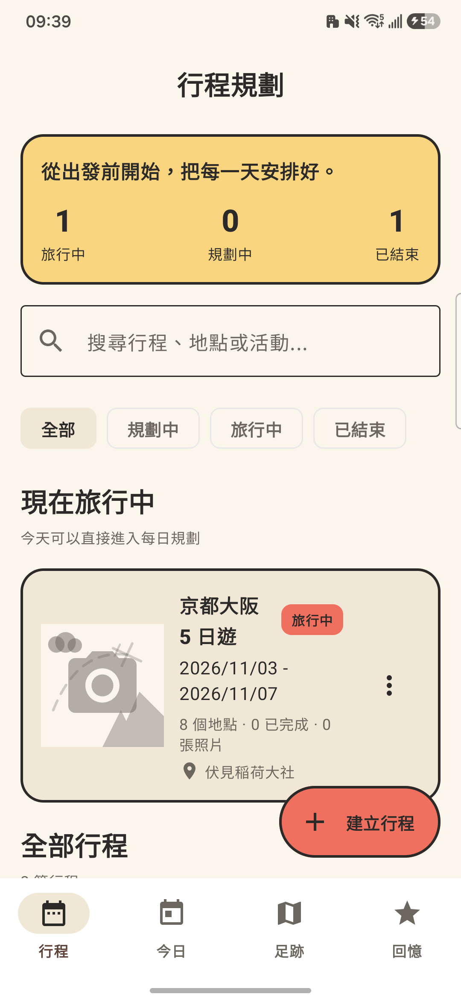
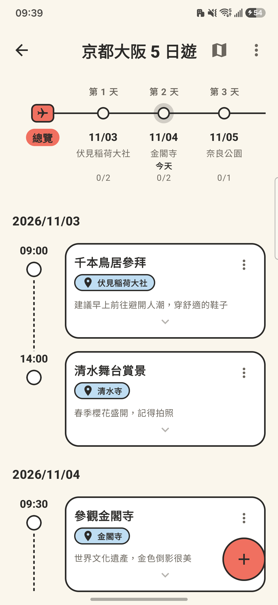
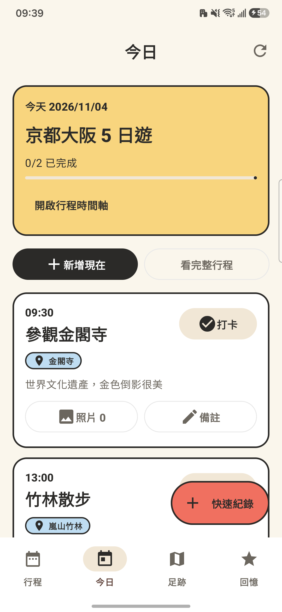
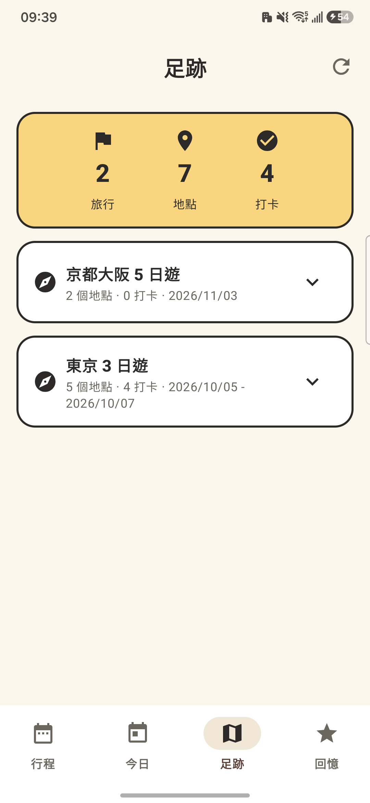
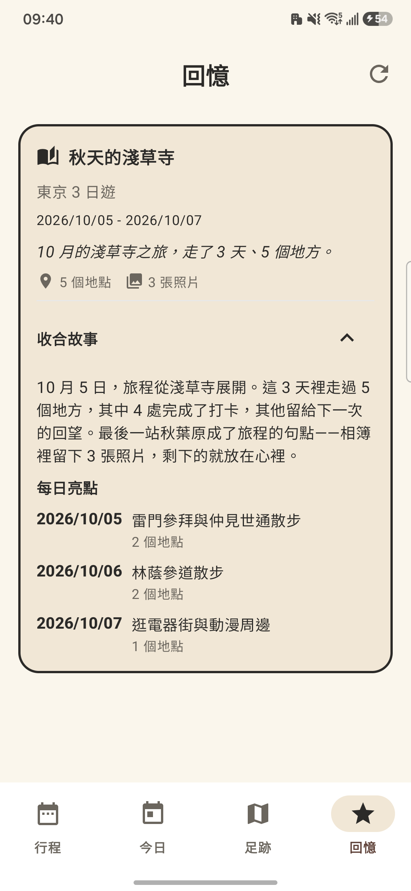
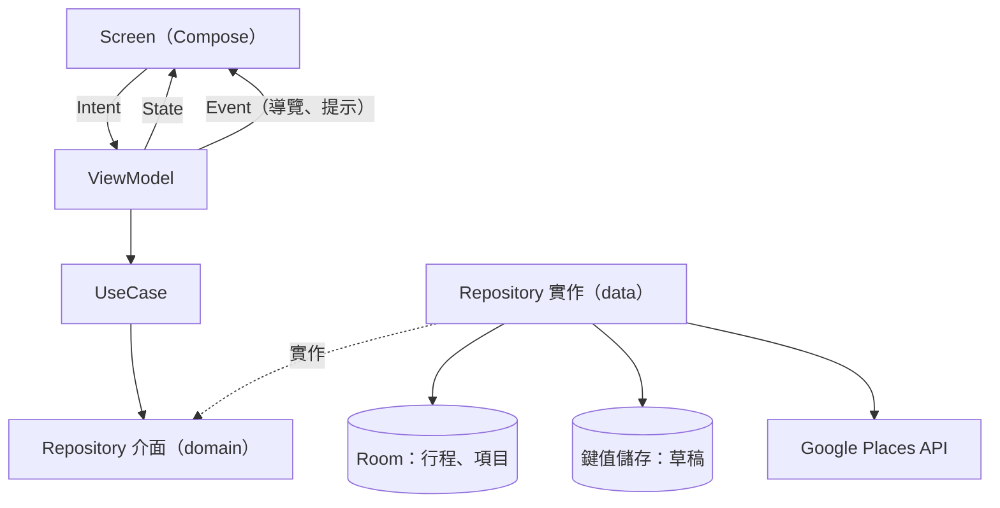

# TravelRecordList

[](https://github.com/ppking2897/TravelRecordList/actions/workflows/ci.yml)

給自助旅行者用的「行程本＋旅行日記」：出發前排好每天要去哪，旅途中打卡、隨手記錄，回來後回顧去過的地方。不需要帳號，資料只存在手機上。

以 Kotlin Multiplatform + Compose Multiplatform 開發，Android 是目前完整可用的平台。

| 行程列表 | 行程詳情 | 今日 | 足跡 | 回憶 |
|---|---|---|---|---|
|  |  |  |  |  |

截圖為 Android 實機，內容是 App 第一次安裝時放入的範例行程。

## 功能

| 階段 | 能做的事 | 分頁 |
|---|---|---|
| 出發前 | 建立行程、排每天的地點與時間、搜尋地點（Google Places）、依天產生路線並分享成文字 | 行程 |
| 旅途中 | 看今天要去哪、到了打卡、快速補一筆紀錄、加照片與備註 | 今日 |
| 回來後 | 看去過哪些地點與統計、讀已結束行程自動產生的旅行小故事 | 足跡、回憶 |

其他：備註裡的 `#字詞` 自動成為標籤，點標籤可篩出同標籤的項目；卡片左滑刪除、右滑編輯；新增行程自動存草稿；第一次安裝放入兩趟範例行程。

## 平台支援

| 項目 | Android | iOS |
|---|---|---|
| 系統版本 | Android 7.0 以上 | 未定 |
| 建置與實機測試 | 有 | 目前版本還沒在 Mac 上建置過 |
| 地點搜尋 | 可用（需設定 API key） | 不可用：還沒實作讀取 key |
| 照片 | 可用 | 不可用 |
| 地圖頁 | 地點列表＋跳轉 Google 地圖 | 只有佔位畫面 |

不支援 Web。`composeApp/src/` 底下的 `jsMain`、`wasmJsMain`、`webMain` 是早期 Web 版留下的程式碼，目前建置設定沒有宣告 Web target，這些檔案不會被編譯，也沒有跟著其他平台更新。

## 架構

Feature-first：每個功能收在 `feature/` 下，內部分 data / domain / presentation 三層；畫面用 MVI（Model-View-Intent，單向資料流）。



- **沒有後端**：行程與項目存在 Room 資料庫；草稿存在鍵值儲存；路線不存檔，打開時依行程現算。唯一的網路呼叫是地點搜尋。
- **分層依賴寫成測試**：哪一層、哪個套件可以依賴誰，違反時 JVM 測試會失敗（規則見 [`.claude/docs/architecture-rules.md`](.claude/docs/architecture-rules.md)）。

```
composeApp/src/
├── commonMain/kotlin/io/github/ppking2897/travelrecord/
│   ├── App.kt          # 底部四個分頁與行程分頁的導覽（Navigation 3）
│   ├── core/           # 跨功能共用：資料庫、網路、主題、共用元件、導覽路由
│   ├── feature/        # 各功能，內部分 data / domain / presentation
│   │   ├── itinerary/          # 行程（資料）
│   │   ├── itinerary_item/     # 行程項目（資料）＋新增／編輯項目畫面
│   │   ├── route/              # 路線（資料）＋路線畫面
│   │   ├── draft/              # 草稿（資料）
│   │   ├── memory/             # 回憶故事產生＋回憶畫面
│   │   ├── itinerary_list/     # 行程列表畫面
│   │   ├── itinerary_detail/   # 行程詳情畫面
│   │   ├── itinerary_add_edit/ # 新增／編輯行程畫面
│   │   ├── itinerary_map/      # 地圖畫面
│   │   ├── today/              # 今日畫面
│   │   └── footprint/          # 足跡畫面
│   └── di/             # Koin 模組加總
├── androidMain/        # Android 平台實作（資料庫、照片存檔與選取、分享、地圖）
├── iosMain/            # iOS 平台實作
├── commonTest/         # 共用測試：Repository 合約、ViewModel、UseCase、架構規則
└── androidHostTest/    # 在 JVM 上跑 Room 版 Repository 的測試
androidApp/             # Android 殼（application module）
iosApp/                 # iOS 殼（Xcode 專案）
```

## 建置與執行

需要 JDK 17 以上（CI 用 21）。

1. 在 `local.properties` 設定地點搜尋用的 key（沒設也能執行，只是地點搜尋不會出現建議）：

   ```properties
   GOOGLE_PLACES_API_KEY=你的 key
   ```

2. 建置或安裝 Android 版：

   ```bash
   ./gradlew :androidApp:assembleDebug   # 建 APK
   ./gradlew :androidApp:installDebug    # 裝到連接的手機
   ```

3. iOS：用 Xcode 開啟 `iosApp/`（需要 Mac）。

## 測試

```bash
./gradlew :composeApp:testAndroidHostTest
```

在 JVM 上執行，Windows、macOS、Linux 都能跑。結果檔在 `composeApp/build/test-results/testAndroidHostTest/`。GitHub Actions 每次 push 都會建置 APK 並跑這組測試，結果檔裡的測試數是 0 也會判失敗。

- **Repository**：行為規格寫成合約測試，記憶體版與 Room 版綁同一份合約。
- **ViewModel／UseCase**：用記憶體版資料層組裝，時間相關的邏輯注入固定時鐘。
- **架構**：分層依賴規則，連測試檔一起檢查。

## API key 的安全取捨

地點搜尋目前從 App 直接呼叫 Google Places API，key 會包在安裝檔裡，有被取出盜用的風險。計畫改成在 Google Cloud Console 限制 key 的用途與配額，之後再改用 Places SDK 搭配 Firebase App Check。自己建置時請用有設定限制的 key。

## 技術棧

| 類別 | 使用 |
|---|---|
| 語言 | Kotlin 2.2.20 |
| UI | Compose Multiplatform 1.10.3、Navigation 3 |
| DI | Koin 4.0.1 |
| 資料 | Room 2.8.5（KMP）、kotlinx-serialization |
| 網路 | Ktor 3.0.3 |
| 圖片 | Coil 3、ZoomImage、Peekaboo（選取照片） |
| 測試 | kotlin-test、Kotest、kotlinx-coroutines-test |
| 建置 | AGP 9、KSP、BuildKonfig |

## 授權

[MIT](LICENSE)
